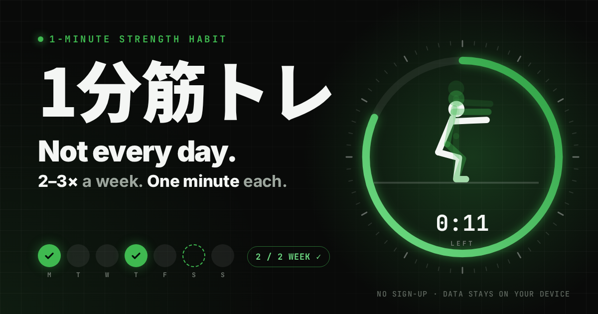

# 1分筋トレ（kintore-habit）



毎日じゃなくていい。週2〜3回、1分から始める筋トレ習慣のウェブアプリです。

- **公開URL：https://daisuke-awaji.github.io/kintore-habit/**
- ログイン不要。記録はブラウザ（localStorage）にだけ保存され、外部には送信されません。
- スマホのホーム画面に追加すると、アプリのように使えて、オフラインでも開けます。

## 特長

「続かない」原因をUIモックのレビュー（[docs/usability-review.md](docs/usability-review.md)）で洗い出し、その対策を前提にして作っています。

| 続かない原因 | このアプリでの対策 |
|---|---|
| 毎日の連続記録が、休むと途切れる | 目標は **週◯回**（初期値は週2回）。毎日の連続日数は出さない |
| 途切れた数字を見て落ち込む | 主役は **減らない数字**（通算回数・目標を達成した週・始めてからの日数） |
| 何をすれば今日はOKか分からない | **どのメニューでも1分やれば「今日のぶん、できた」** |
| 休むと罪悪感がある | 「今日は休む」で **回復日** にできる。やらなかった日に赤や×は付けない |
| 久しぶりに開くのが気まずい | ふだんの間隔より長くあくと **「おかえり」** と軽めのメニューを出す。休んだ日数には触れない |
| 記録し忘れて記録が途切れる | 過去7日分は **あとから追加・削除** できる |
| 筋肉痛や痛みの日にやることがない | 体の調子（ふつう／筋肉痛／疲れぎみ／痛みがある）に合わせて、ストレッチや軽いレベルを出す |
| 運動中は画面を見られない | 大きな合図と残り時間、**音声ガイド・効果音・振動**、画面を消さない設定。アプリを切り替えると自動で一時停止 |
| きつすぎる・物足りない | 終わったあとの「きつさ」から、次回のレベル変更を **本人に確認して** 提案 |
| 集合住宅で音が気になる | 全種目、跳ばない・道具なし（椅子と壁だけ） |

種目は3部位×3レベルと回復のストレッチです（下半身：椅子スクワット→スクワット→ゆっくりスクワット、上半身：壁腕立て→膝つき腕立て→腕立て伏せ、体幹：膝つきプランク→プランク→長めのプランク）。どれも1分で、横から見た人の動きのイラストが合図に合わせて動きます。

## データとプライバシー

- 記録はこのブラウザの localStorage にだけ保存します。サーバーやアクセス解析はありません。
- 設定画面から、記録の **書き出し（JSON）・読み込み・全削除** ができます。機種変更のときは書き出したファイルを読み込んでください。
- **iPhone の Safari の注意**：Safari では、しばらくサイトを開かないと localStorage が消されることがあります（WebKit のトラッキング防止。ホーム画面に追加したウェブアプリは対象外）。アプリ内でも「ホーム画面に追加」を案内しています。

## 注意

このアプリは医療のアドバイスではありません。持病のある方や痛みがある方は、始める前に医師に相談してください。運動中に痛みや気分の悪さを感じたら、すぐにやめてください。

## 開発

Node.js 22 以上が必要です。

```bash
npm ci
npm run dev      # 開発サーバー（http://localhost:5173/kintore-habit/）
npm test         # ユニットテストと画面の動作テスト（Vitest）
npm run build    # 型チェックと本番ビルド（dist/）
```

| 用途 | 使っているもの |
|---|---|
| ビルド | Vite |
| UI | React + TypeScript |
| 保存データの検証 | Zod（読み込み時に必ず検証し、壊れていたら退避してから新しく始める） |
| テスト | Vitest（日付・週・判定ロジックのユニットテスト、jsdom での画面の動作テスト） |
| 画面遷移 | 自前のハッシュルーター（`#/log` など） |
| オフライン | 手書きの Service Worker（`public/sw.js`） |

```
src/
  domain/      画面に依存しないロジック（日付、週の目標、おかえり判定、メニュー、種目とポーズ、保存）
  state/       記録の読み書き（Context）
  hooks/       1分のタイマー、画面を消さない設定
  services/    効果音・音声・振動、端末の判定
  components/  人の動きのイラスト、週の表示、シートなど
  screens/     はじめに／今日／運動／完了／記録／設定
  ui-tests/    画面の動作テスト
```

## 公開

`main` に push すると、GitHub Actions（[.github/workflows/deploy.yml](.github/workflows/deploy.yml)）がテストとビルドをして GitHub Pages に公開します。

## ドキュメント

- [計画書](docs/PLAN.md)
- [実装計画](docs/IMPLEMENTATION_PLAN.md)
- [UIモックのユーザビリティ・継続リスクのレビュー](docs/usability-review.md)（[元のモック](docs/mock/index.html)）
- [動作確認の結果と既知の制限](docs/VERIFICATION.md)

## ライセンス

MIT
